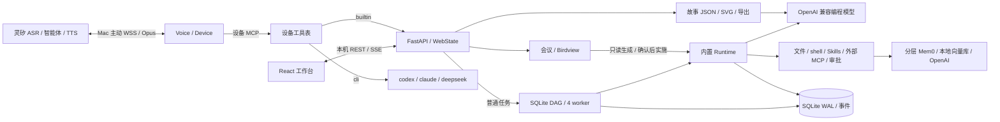

# 咚咚 (dongdong)

通过语音或 Web，让 Mac 上的 AI 读写项目、执行命令，并查看完整任务过程。AirPlay 自动投屏仍受系统限制。

1024 程序设计大赛参赛项目：**通过 AirPlay 连接屏幕，通过语音控制 code agent 做开发。**

## 架构与约束速览

> 2026-10-26 按源码核对；静态快照，不是实时监控。单机 Mac、单用户、一个 Python 服务进程；内部有调度线程及各自事件循环。



- **入口与执行**：`run/web` 同入口、默认 `127.0.0.1:8766`，语音默认关闭。Web 文字始终用 builtin；语音默认 `cli`，配置 `code_backend=builtin` 后复用工作台。普通任务先规划 DAG，再由默认 4 worker 执行；会议生成/实施通过专用 Runtime 路径。
- **状态与存储**：SQLite 是任务、会话和事件的持久来源，任务 SSE 从库回放；故事有独立场景流和 JSON/SVG 文件。配置/会话/产物默认在 `~/.dongdong/`，Mem0 在仓库 `.memory/`，不随 `DONGDONG_HOME` 搬迁。
- **执行边界**：本机 Host/Origin 校验；文件工具受工作区限制，shell/外部 MCP 仍持有进程权限。审批是一次调用确认，不是沙箱。会话闸门防重入，SQLite claim 处理声明文件范围冲突；重启默认暂停遗留调度任务。
- **会议与能力限制**：普通讨论只记录，实施必须确认当前已展示方案和源码基线。调度 Item 使用隔离上下文，当前跳过 Runtime 自动历史/记忆注入；非隔离 Runtime 才自动检索。AirPlay 自动镜像受 macOS 限制；ESP32 尚未实现。
- **开发约束**：先查调用方、优先复用和删除、不为单一调用方抽象、自有文件≤300行；默认不补普通测试，只保护协议/音频/执行边界/鉴权计费；依赖优先标准库和成熟库。规范与现状的差异单独记录，不据现状宣称合规。

完整职责、证据与限制见 [项目架构](docs/architecture.md)；交互版见 [Birdview 架构与约束](docs/birdview/architecture.html)（下载后用浏览器打开）；全部文档见 [文档导航](docs/README.md)。

## 快速开始

需要 macOS、`uv`、系统 Opus 库；构建工作台还需要 Node.js/npm。缺少依赖时可先执行 `brew install uv opus node`。安装脚本使用 Python 3.12。

```bash
./scripts/setup.sh            # 建 venv、装依赖
cd apps/web && npm ci && npm run build && cd ../..
./scripts/dev.sh doctor       # 环境体检（麦克风、扬声器、agent、投屏目标）

# 默认内置模型为 deepseek-flash；也可启动后在“设置”中配置兼容模型
export DEEPSEEK_API_KEY=...
```

文字任务无需绑定灵矽。要使用语音，请在启动工作台前完成设备绑定：

```bash
./scripts/dev.sh bind         # 首次获取激活码，去 https://xrobo.qiniu.com/ 绑定
```

然后启动工作台，打开 <http://127.0.0.1:8766>；使用语音时点击“开启语音”：

```bash
./scripts/dev.sh run          # web 命令也是同一入口
```

也可以直接在终端使用内置 agent，不需要构建前端：

```bash
export DEEPSEEK_API_KEY=...
./scripts/dev.sh chat --message "读一下 README 并总结"
./scripts/dev.sh chat         # 交互对话：/new、/sessions、/quit
```

详细步骤见 [`docs/runbook.md`](docs/runbook.md)。

`web` 和 `run` 二选一启动，语音默认关闭，顶部按钮可随时开启/关闭麦克风和播报。设置页把语音后端设为 `builtin` 后，语音任务和 Web 共享模型、工作区、运行记录和停止入口；配置保存后下一任务生效。

关闭语音会停止采音、播报并断开连接，已派发的编程任务继续执行；停止任务使用对话内的停止按钮。刷新页面保留语音开关状态，重启服务后回到关闭。

对话内会展开执行卡：多步骤任务显示步骤清单、当前与接下来要做的事，工具调用和耗时实时更新。交付后自动折叠，可展开回看；刷新后保留历史。语音发起任务时，点击“查看当前步骤”进入对应任务。连续语音任务会追加到当前任务会话；普通调度 Item 使用隔离模型上下文，历史记录仍可回看，重连和麦克风开关不会创建新会话；需要独立上下文时点击“开启新对话”。步骤由内置 agent 更新，模型未提供清单时显示实际工具或等待状态；此进度卡适用于 `builtin` 后端。

## 任务状态与功能进度

Web 和内置语音任务已接入 SQLite 任务调度，运行记录展示任务项、状态、尝试次数和错误摘要。自动任务会先显示“正在规划任务”，规划完成后展示 Item 数量；规划失败会记录原因并安全回退为单项执行。灵矽可通过 `self.task.status`、`self.task.goal_preview`、`self.task.stop`、`self.task.resume`、`self.task.repair` 查询、预览验收、停止、恢复或修复任务。Run 收口前会记录最终验收阶段并持久化 Goal acceptance、Item 结果摘要和 `goal_verified` 事件；有验收约束但没有 verifier 时进入 `needs_review`，不会误报成功；可选配置 `task_scheduler.model_final_verifier=true` 时才启用只读模型验收，证据不足仍进入 `needs_review`。失败 Item 可追加最多 3 个受限修复 Item；未提供手动指令时模型只能生成 instruction，非法或超限响应会安全回退为单条修复。修复项继承原 Item 的工作区、Agent、scope、验收和重试上下文。进程重启后遗留调度任务默认暂停，配置 `task_scheduler.auto_recover=true` 后才会自动恢复，并在失败时退回暂停，避免自动重放写命令。Item 支持工作区相对读写范围，SQLite claim 会在同一或嵌套工作区内阻止读写/写写冲突，只读范围可并行；Monitor 会检测没有可执行 Item 的停摆 Run 并记录事件。跨进程恢复会在发现仍有效的 Item 租约时跳过接管并记录 `recovery_skipped_active_lease`，租约过期后才回收；更完整的多机协调仍是后续工作。设计与实施范围见 [任务调度计划](docs/superpowers/plans/2026-10-25-task-scheduler.md)。

项目、分层记忆、归档、任务调度、会议代码修改与故事模式已整合到 `main`。故事模式支持语音/按钮进入、实时 SVG 画布、故事恢复，以及 PNG、PDF、MP4 导出。故事保存在 `~/.dongdong/stories/<story_id>/`；MP4 使用项目内 `tools/ffmpeg/`，不依赖系统 PATH。仓库内同时提供 macOS arm64 与 x86_64 FFmpeg，并在导出前校验 SHA-256；该构建启用了 GPL、version3 和 nonfree 组件，公开分发前需复核许可证义务。

## 项目、记忆与归档

侧栏创建项目时点击“选择文件夹”，通过 macOS 系统窗口选择已有目录（仅可选文件夹），项目名称默认取文件夹名。每组显示最近20条会话并支持加载更多。旧会话保留在“未分类”。文字任务使用所属项目目录；浏览历史不切换语音项目，语音前明确选择“设为语音项目”，重启服务后重新选择。

会话可移动、归档或恢复；移动从下一轮使用新目录和记忆范围，不搬文件或已有记忆。归档保留消息、运行、事件与会议方案，恢复后才能继续操作。

## 技能、外部工具和审批

- **技能**：将已有技能放到 `~/.dongdong/skills/<名称>/SKILL.md`，在“技能”页刷新、查看和启停。内置 agent 先看描述，需要时读取完整指令；不自动下载或安装。
- **MCP**：在“MCP”页添加本机 stdio、Streamable HTTP 或 SSE 服务，保存后可测试连接和查看工具。只有启用的服务才会在任务开始时连接，任务结束或取消后关闭。密钥放环境变量或请求头字段（支持 `${ENV}`），列表不回显其值。
- **会议代码修改模式**：新对话选择 Git 项目目录后进入；多人讨论只记录，说“咚咚，整理一下方案”生成方案与 Birdview 改动地图，按钮或“按这个方案实施”确认当前版本后执行。首次运行 `./scripts/setup-birdview.sh`，步骤见 [操作手册](docs/runbook.md)。首版接内置 Runtime。
- **审批**：设置中的“工具执行方式”默认自动执行；切换“逐次确认”后，内置 agent 写文件、跑命令、保存记忆、调用外部 MCP 工具前会等待“允许一次”或“拒绝”。审批卡在所有页面可见。独立 `chat/call/serve` 入口没有 Web 审批回调，会拒绝需要确认的内置工具操作；外部 CLI 后端仍使用各 CLI 自身的权限机制。

## 长期记忆与数据

非隔离 Runtime 每轮自动检索全局与当前会话项目的记忆；当前普通调度 Item 使用隔离上下文，跳过自动检索，但可显式调用记忆工具。用户明确要求记住时使用 `memory_save`，默认本项目，跨项目偏好选 `global`。逐次确认模式审批保存。工作台“记忆”页可按范围查看、添加和删除；设备工具 `self.memory.search/save/list/delete` 由灵矽模型选择调用，搜索合并两层，写入/删除按明确范围执行。需要为服务进程设置 `OPENAI_API_KEY`，它与编程模型的 key 独立。保存文字和搜索查询会发送到 OpenAI，向量和记忆历史存于仓库 `.memory/`。配置步骤见 [长期记忆](docs/runbook.md#7-长期记忆)。

配置默认存于 `~/.dongdong/config.json`，会话、运行、事件及任务状态存于 `~/.dongdong/dongdong.db`；普通语音只保存识别与播报文字，不保存音频。`DONGDONG_HOME` 可更换配置和会话库目录，Mem0 的 `.memory/` 路径不随之改变。


## 目录

| 目录 | 放什么 |
| --- | --- |
| `apps/device-mac/` | Mac 设备端：灵矽 WS 协议、音频、MCP 工具实现 |
| `apps/web/` | React + Vite + Tailwind 工作台；构建后由 Python 服务 |
| `firmware/` | ESP32 固件规划（复用 xiaozhi-esp32） |
| `docs/` | [架构](docs/architecture.md) · [协议摘要](docs/linx-protocol.md) · [操作手册](docs/runbook.md) · [接入 agent](docs/agents.md) · [语音提示词](docs/linx-voice-prompt.md) · [决策记录](docs/decisions.md) |
| `scripts/` | setup / dev / check |
| `deploy/` | launchd 自启、环境变量样例 |
| `tests/` | 协议/路径/迁移、agent loop/传输/MCP、任务调度、会议与故事边界；`check.sh` 统一运行 |

## 语音指挥本地 agent

灵矽云端仍然负责 ASR/对话/TTS；需要操作 Mac 时，云端模型调用设备 MCP 的 `self.code.run`，
Mac 上的 agent 执行。**不需要公网穿透，也不开放入站端口。**

```json
{ "code_backend": "builtin" }
```

默认 `cli` 保持旧 codex/claude 路径不变；改成 `builtin` 后走本地 `Runtime`。提示词模板、
等待时间和安全边界见 [`docs/linx-voice-prompt.md`](docs/linx-voice-prompt.md)。内置语音调用最多同步等待8秒，未完成时返回任务号供后续查询；CLI 的 `timeout_s` 是同步等待时间，超时后任务仍可能继续执行。

## 接入自己的 agent

使用 `code_backend=cli` 时，`codex` / `claude` / `deepseek` 都是配置项。想换成 ollama、某个内部 CLI，修改 `~/.dongdong/config.json` 的 `agents`，并将 `agent` 设为对应名称：

```json
{ "code_backend": "cli", "agent": "ollama", "agents": { "ollama": { "cmd": ["ollama", "run", "qwen2.5-coder:7b", "{prompt}"], "timeout_s": 300 } } }
```

见 [docs/agents.md](docs/agents.md)。

Web 文字和 `chat` 始终使用内置 Runtime，模型在 `model` 配置或工作台“设置”中更换。工作台默认仅允许本机访问；文件工具受工作区边界限制，shell 和外部 MCP 仍具有服务进程权限，审批不等于系统沙箱。

## 规矩

开发规范见 [`AGENTS.md`](AGENTS.md)：不写冗余单测、能借开源库就不自己写、单文件不超 300 行。
