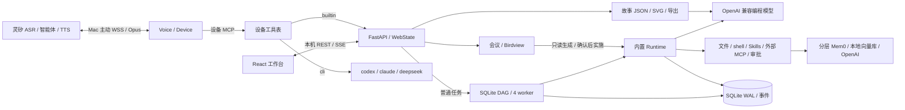
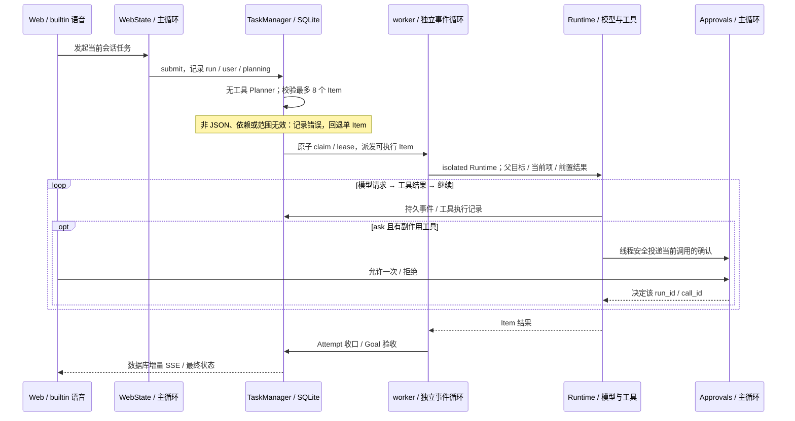
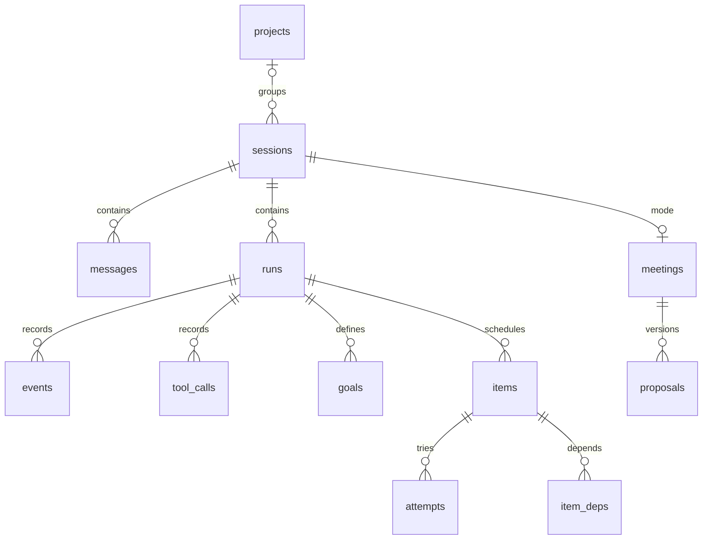

# 项目架构与约束

> 核对日期：2026-10-26。源码基线：`378f453cb7391482cc2b7610876465b825623c91`。本次只更新文档和架构展示产物。证据行号按上述固定提交定位，工作区继续变化时行号可能不同。工作期间另有并行的 `project_files.py` / Web 路由 / 测试改动，不属于本次变更；本文以固定已提交基线为主，未纳入进行中的文件浏览功能。
> 当前实现以入口、调用链和清单为证据；历史设计是背景材料，不自动代表已交付能力。文档入口见 [文档导航](README.md)。

## 架构与约束速览

> 2026-10-26 按源码核对；静态快照，不是实时监控。单机 Mac、单用户、一个 Python 服务进程；内部有调度线程及各自事件循环。



- **入口与执行**：`run/web` 同入口、默认 `127.0.0.1:8766`，语音默认关闭。Web 文字始终用 builtin；语音默认 `cli`，配置 `code_backend=builtin` 后复用工作台。普通任务先规划 DAG，再由默认 4 worker 执行；会议生成/实施通过专用 Runtime 路径。
- **状态与存储**：SQLite 是任务、会话和事件的持久来源，任务 SSE 从库回放；故事有独立场景流和 JSON/SVG 文件。配置/会话/产物默认在 `~/.dongdong/`，Mem0 在仓库 `.memory/`，不随 `DONGDONG_HOME` 搬迁。
- **执行边界**：本机 Host/Origin 校验；文件工具受工作区限制，shell/外部 MCP 仍持有进程权限。审批是一次调用确认，不是沙箱。会话闸门防重入，SQLite claim 处理声明文件范围冲突；重启默认暂停遗留调度任务。
- **会议与能力限制**：普通讨论只记录，实施必须确认当前已展示方案和源码基线。调度 Item 使用隔离上下文，当前跳过 Runtime 自动历史/记忆注入；非隔离 Runtime 才自动检索。AirPlay 自动镜像受 macOS 限制；ESP32 尚未实现。
- **开发约束**：先查调用方、优先复用和删除、不为单一调用方抽象、自有文件≤300行；默认不补普通测试，只保护协议/音频/执行边界/鉴权计费；依赖优先标准库和成熟库。规范与现状的差异单独记录，不据现状宣称合规。

## Birdview 快照与覆盖范围

[交互架构与约束页](birdview/architecture.html) 是离线、自包含 HTML；在本地浏览器中打开才是交互视图，代码编辑器只显示源码。本轮遵守“不控制浏览器”的要求，**未打开或操作浏览器，也未完成视觉验收**。

| 身份 / 产物 | 内容 |
| --- | --- |
| project.id / mapId / revision | `dongdong` / `dongdong-system` / `3` |
| [architecture.json](birdview/architecture.json) | 15 个职责模块、30 条有源码证据的关系；Overview 为主链，All relations 包含持久化/扩展细节 |
| [constraints.catalog.json](birdview/constraints.catalog.json) | committed HEAD 发现的 15 个来源、73 个原文区段；区段数不是有效规则数 |
| [reviewed-rules.json](birdview/reviewed-rules.json) | 人工提炼 42 条：根 AGENTS 33 条项目规范与 decisions 中 9 条当前运行决策 |
| [architecture.constraints.json](birdview/architecture.constraints.json) | 编译后的原文范围和 Git 行历史；规则版本与地图 revision 各自独立 |

检查范围覆盖 `apps/device-mac` 的启动、服务、任务、会议、语音、故事、工具、持久化模块，以及 `apps/web` 的清单、构建入口、组件调用和 SSE；另检查 `firmware/README.md`、`scripts/check.sh`、launchd、FFmpeg 导出入口。两个应用均有独立职责呈现：`web` 是 React 应用，其余本地模块属于 Mac Python 应用；外部节点不声明本地文件所有权。

`firmware` 仅规划，不在现有执行图中虚构 ESP32 节点；`panel.py/panel.html` 是已检查的旧入口遗留，`run/web` 不启动。`design/`、`design2/` 不属于当前构建入口，未审查其原型内部。没有验证云端账户配置、真实音频/AirPlay/外部 MCP 服务，也没有解读第三方二进制内部实现。

约束收集排除 14 个别名/重复译文，队列未检查路径为 0；仍有 2 个 vendor 文档引用缺失（`CONTRIBUTING.md` 与审计说明引用的 `SKILL.md`）。**来源发现不等于语义审阅**：完整审阅了根规范，决策记录仅选择当前相关边界；vendor 技能及其引用未逐条提炼。用户本轮操作约定和未跟踪的 `.agents/skills/birdview` 已单独阅读，不冒充 committed HEAD 来源或伪造版本历史。规则适用不等于实现已验证合规。

## 模块职责、所有权与证据

下表与 Birdview JSON 使用相同模块 ID；路径表示已读证据，全部 ownership 列表在 JSON 中。外部 API 的本地适配器是证据，不是外部系统的所有权。

| 模块 ID / 名称 | 职责与边界 | 代码证据（点击定位） | 不确定性 / 限制 |
| --- | --- | --- | --- |
| `web` / Web 工作台 | React 19 / Vite / Tailwind；会话、任务 SSE、审批、会议地图与故事 SVG。 | [apps/web/src/main.jsx](../apps/web/src/main.jsx#L17) | 本轮静态源码证据支持；未作真实服务联调 |
| `host` / 本机 API 与会话宿主 | FastAPI 同源静态站点、REST/SSE、项目归档及语音开关；WebState 路由任务与模式。 | [web_server.py](../apps/device-mac/dongdong/web_server.py#L52) | 本轮静态源码证据支持；未作真实服务联调 |
| `scheduler` / SQLite 任务调度 | Planner → DAG Item → claim/lease → 默认 4 worker；重试、暂停恢复、修复与 Goal 验收。 | [task_scheduler.py](../apps/device-mac/dongdong/task_scheduler.py#L23) | 支持显式开启的跨进程自动接管和可选模型最终验收；更完整跨进程协调、多机调度尚未实现，当前仍为单主机设计。 |
| `runtime` / 内置 Agent 循环 | 消费模型流、执行工具并记录事件；调度 Item 在 worker 独立事件循环执行，会议在主循环执行。 | [runtime.py](../apps/device-mac/dongdong/runtime.py#L21) | 本轮静态源码证据支持；未作真实服务联调 |
| `models` / 编程与场景模型 API | OpenAI 兼容 chat/completions；编程 Runtime、无工具 Planner 和故事场景各有调用路径。 | [llm.py](../apps/device-mac/dongdong/llm.py#L94) | 本轮静态源码证据支持；未作真实服务联调 |
| `voice` / Mac 语音设备 | Voice 管启停；Device 主动 WSS 连接灵矽，Opus 录放，STT/TTS 文字分流回宿主。 | [voice.py](../apps/device-mac/dongdong/voice.py#L15) | 本轮未验证真实收音、TTS、断线重连和平台限流。 |
| `meeting` / 会议与 Birdview | 讨论仅记录；只读生成地图，确认绑定方案哈希、展示记录、截止序号与源码指纹后实施。 | [meeting.py](../apps/device-mac/dongdong/meeting.py#L19) | shown 记录不证明人已阅读；shell 事后范围检查不是沙箱。 |
| `storage` / 本地持久化 | SQLite WAL 保存项目/会话/Run/Goal/Item/Attempt/事件；配置、技能及故事/会议产物另存文件。 | [store.py](../apps/device-mac/dongdong/store.py#L21) | 本轮静态源码证据支持；未作真实服务联调 |
| `capabilities` / 工具、扩展与审批 | 文件工具守工作区，shell 管进程组；本地 Skills 按需读，外部 MCP 按轮连接，ask 审批单次调用。 | [builtin_tools.py](../apps/device-mac/dongdong/builtin_tools.py#L124) | shell 与外部 MCP 持有进程权限，不能承诺系统隔离。 |
| `external-mcp` / 用户外部 MCP 服务 | Runtime 通过官方 MCP SDK 连接启用的 stdio / Streamable HTTP / SSE 服务。 | [mcp_client.py](../apps/device-mac/dongdong/mcp_client.py#L20) | 本轮静态源码证据支持；未作真实服务联调 |
| `linx-cloud` / 灵矽语音平台 | 云端 ASR、对话智能体和 TTS；作为设备 MCP client 选择调用 Mac 工具。 | [linx.py](../apps/device-mac/dongdong/linx.py#L22) | 本轮静态源码证据支持；未作真实服务联调 |
| `device-tools` / 设备工具与系统集成 | 设备 MCP / HTTP bridge 共用工具表；builtin 回 WebState，cli 启子进程，screen 做 mDNS 与投屏脚本。 | [tools.py](../apps/device-mac/dongdong/tools.py#L89) | AirPlay 自动镜像在已记录的 MenuBarAgent 环境受阻；ESP32 只有规划。 |
| `story` / 故事场景与导出 | 会话级 StorySession：STT → 受控 JSON → SVG；独立场景流，按故事 ID 保存并导出 PNG/PDF/MP4。 | [story.py](../apps/device-mac/dongdong/story.py#L20) | PNG/PDF 当前只导出首幕；MP4 为全场景加静音 AAC。 |
| `memory` / 分层长期记忆 | Mem0 使用全局/项目命名空间；本地 Qdrant 与 SQLite 历史，提取/嵌入调用 OpenAI。 | [memory.py](../apps/device-mac/dongdong/memory.py#L14) | .memory 位于源码仓库根，不随 DONGDONG_HOME 迁移。 |
| `memory-cloud` / OpenAI 记忆服务 | 接收待保存文本及查询；提供 Mem0 的记忆提取模型和文本嵌入。 | [memory.py](../apps/device-mac/dongdong/memory.py#L14) | 本轮静态源码证据支持；未作真实服务联调 |

核心关系：Web → Host → Scheduler → Runtime → 模型/工具；语音 Device → 设备工具 → builtin Host 或外部 CLI；Host → Meeting → 专用 Runtime；Host → Story → 场景模型/文件。结果经任务数据库 SSE、故事场景 SSE 或设备 MCP 查询分别返回。

## 入口、进程与并发边界

| 入口 | 实际路径 | 边界 |
| --- | --- | --- |
| `run` / `web` | `__main__ → web_server.serve` | 同一 Python 服务；FastAPI 同时提供静态站点和 API，默认 loopback 8766 |
| Web 文字 | `WebState.start → TaskManager.submit → Planner → Item worker → Runtime` | 始终 builtin，默认共享 4 个 worker；每个 builtin Item 的 `asyncio.run` 建独立事件循环 |
| builtin 语音 | `Device → mcp.handle → tools → WebAgent → WebState.start` | Device 线程调用同步工具；WebAgent 投回宿主主循环，普通任务仍进入调度器 |
| CLI 语音 | `tools → agent.run → CLI 子进程` | 默认 `code_backend=cli`；agent 由 CLI 自己管理模型/工具循环 |
| 会议 | `Meeting → WebState.start(meeting_options) → Runtime` | 跳过普通任务 DAG；主事件循环的专用异步任务，生成/实施用不同工具集 |
| `chat` | `chat_cli → Runtime` | 独立终端进程；无 Web 审批回调，不经过工作台 TaskManager |
| `call` / `serve` | `tools.call` / `bridge → tools.call` | 未绑定 WebAgent 时 builtin 懒建 AgentService 线程与事件循环；serve 默认 HTTP 8765 |
| `bind` / `doctor` / `airplay` | 绑定、环境诊断、发现和投屏 | 辅助命令；Node 正常服务仅用于固定 Birdview 渲染，前端由 Vite 预构建 |

`work_gate` 是进程内线程锁：同一会话不可重入，不同会话可工作；无 scope 的设置变更/旧设备入口全局独占，冲突返回 409。清理完成才释放闸门。直接 `chat/Runtime` 不经过这道闸门，不能据此承诺多个进程同时改同一目录安全。

调度 Item 的工作区相对 `scope.read/write` 在 Store 中解析成绝对路径；SQLite `BEGIN IMMEDIATE` 中原子 claim 检查同一/嵌套目录的运行 Item，读读可并行，读写/写写重叠及未声明范围按冲突等待。这是已声明范围的调度协调，不限制 shell 实际访问路径。每个 Run 有管理线程，共用有界 worker 池；lease 续租、过期回收、重试/停摆检测和有限 drain 均由同一调度实现处理。

重启时遗留调度 Run 默认 `paused`，需显式恢复；只有布尔 `task_scheduler.auto_recover=true` 才自动恢复，失败回到暂停。旧无 Item 的 orphan run 按 Store 规则停止。当前没有多机协调、完整的跨进程唤醒编排或操作系统沙箱；自动接管失败会退回暂停。

`call` 是一次性进程，其 daemon AgentService 在主进程退出后不能保证长任务继续；长任务用持续运行的 `run/web`。CLI `timeout_s` 表示同步等待超时，任务可能继续；builtin 设备工具最多等待 8 秒，超时返回 job/run 标识供查询。

## 普通任务、上下文与回放



Planner 的 DAG 与 Runtime `update_plan` 不同：前者控制 Item 调度，后者仅提供模型可见进度（1–8 步、至多一项进行中）。Run/Goal/Item/Attempt 结果、验收证据和错误摘要持久化；有验收约束但没有 verifier 时为 `needs_review`，不会把模型说完成当成通过验收。配置 `task_scheduler.model_final_verifier=true` 且提供模型时，可启用严格 JSON 的只读模型最终验收；异常、格式错误或证据不足仍为 `needs_review`，默认关闭。

当前 `runtime.max_steps=1000`，历史软窗口为 30 条；非隔离 Runtime 保留任务起始及完整工具消息对，并自动检索全局/项目记忆。**普通调度 Item 传 `isolated=True`，实际只接父目标、当前 Item、验收与前置结果，跳过会话历史及自动记忆注入；不能据会话连续 ID 宣称所有入口都复用模型上下文。** 显式 `memory_search/save` 工具仍在普通 Item 工具集中。会议生成同样隔离且只开放专用工具集。

任务 SSE 从 `events` 按 id 增量读取，`since` 可续读，终态且宿主收尾后发 `event: end`。刷新与历史查询可回放；`run_start.user_message_id` 关联执行卡。取消等待 Runtime、进程组和连接清理，保留部分文件修改，不自动回滚。

## 语音、工具与扩展

灵矽负责 ASR/智能体/TTS；Mac 从 OTA 获取连接信息后主动建立 WSS，sounddevice 录放 PCM、opuslib 编解码。平台可能每轮重连，WS session_id 不是本地会话边界。`echo_guard` 播放期间闭麦，不能保证边说边打断。普通语音只存 STT/TTS 文字，不存音频。

开关语音只管理采音/播报/连接；关闭不会取消已派发编程任务。浏览历史不等于切换语音项目；显式选择后语音跟随当前会话，重启不恢复选择。会议和故事在同一会话互斥，故事录音时不能再发起该会话代码任务。后台完成不会自动改变当前选择；长任务完成主动语音回报尚未实现。

| 工具体系 | 角色与调用方 | 内容 |
| --- | --- | --- |
| 设备工具 `tools.TOOLS` | 灵矽是 MCP client；Mac 是工具提供方；也供 call/HTTP bridge 使用 | `self.code.*`、`self.task.*`、`self.screen.*`、`self.memory.*`、状态 |
| Runtime 工具 | 编程模型的 function schemas | 文件读写、shell、update_plan、read_skill、memory_search/save 与已启用外部 MCP |
| 外部 MCP | Mac 是 client，官方 Python SDK 连接用户服务 | stdio / Streamable HTTP / SSE；不自动暴露为设备 MCP 工具 |

Skills 只发现本地 `~/.dongdong/skills/<name>/SKILL.md`，启用摘要按需读正文；拒绝路径穿越、外链、禁用项及超过 32KB 正文，不自动下载/安装或运行技能脚本。

外部 MCP 按每次 Runtime 调用建立/关闭连接，工具映射为 `mcp_<服务名>_<索引>`；连接/发现默认 15 秒、调用默认 180 秒。单服务失败写 `mcp_error`，其他服务可继续；清理异常保留原取消/任务结果。

`tool_policy=auto` 默认自动执行；ask 对 shell、write/edit、memory_save、所有外部 MCP 工具确认一次。审批按 `(run_id, call_id)` 匹配、不持久化；前端按所选对话过滤待审批，独立入口无回调时拒绝这些调用。服务启动/连接不属于工具调用审批。模型 key 和 MCP env/header 值不经查询 API 回显，但工具参数/结果会进事件库，不能据此承诺所有用户输入都脱敏。

## 会议与故事模式

会议要求 Git 工作区；普通 STT/文字只记讨论，TTS 不作为人类确认。完整“整理一下方案”才生成，“按这个方案实施”或按钮才确认；会议期间云端 self.code.run 只返回状态。生成阶段只读工具 + 固定 Node Birdview 命令，不开放 shell、产品写入、外部 MCP。

方案正文不可变；SQLite 条件更新只领取当前已展示版本一次，绑定哈希、讨论截止序号和源码指纹（含可见未跟踪/未提交内容）。新讨论或源码变化导致重新整理。shown 是 HTML 读取/iframe load 回执，不证明人已阅读。产物按注册 ID 和会话校验读取，CSP sandbox iframe 只允许脚本、不给同源权限。

实施接固定文件范围与阶段记录。shell 返回后比较 Git 可见文件指纹，额外变化会停止并报告，不自动回滚；无法预先拦截、覆盖 Git 忽略路径或项目外文件。实际 diff 取本次实施前后内容，避免把用户已有改动算成本次成果。最终事件记录检查、统计和产物 ID；命令退出码本身不等于完整验收。

故事是会话级 StorySession：用户最终 STT → 分段缓冲 → 无工具模型请求 → `normalize_scene` 受控结构 → SVG。场景失败保留可见回退；场景 SSE 使用进程内事件与游标，JSON/SVG/manifest 持久化，**不同于任务数据库 SSE**。历史可从文件恢复/重播，不自动开启麦克风。

导出后台任务支持 PNG/PDF/MP4。PNG/PDF 当前只首幕，CairoSVG → Playwright → macOS Quick Look 回退；MP4 按所有场景时长合成，带静音 AAC，不保存/恢复原始口述音频。FFmpeg 按 CPU 选择仓库二进制并验 SHA-256，不回退系统 PATH；当前构建含 GPL/version3/nonfree，公开分发前要复核许可。

## 数据关系与落点



| 数据 | 默认位置 / 权威来源 |
| --- | --- |
| 配置、设备身份、key 引用 | `~/.dongdong/config.json`，保存 0600，根目录 0700；settings 表非当前配置源 |
| 项目、会话、运行、事件、DAG、会议方案 | `~/.dongdong/dongdong.db`，SQLite WAL、外键、共享连接锁 |
| Skills | `~/.dongdong/skills/<name>/SKILL.md` |
| 会议地图、活动与 diff | `~/.dongdong/meetings/<artifact_id>/` |
| 故事 | `~/.dongdong/stories/<story_id>/manifest.json`、场景 JSON/SVG、exports |
| Mem0 | 源码仓库 `.memory/qdrant/` 与 `.memory/history.db`；不随 DONGDONG_HOME 移动 |
| 工作区文件 | 会话项目固定目录；未分类使用 cfg.workspace；CLI 独立路径按 projects 白名单 |
| Web 构建 | Vite 输出 `apps/device-mac/dongdong/static/`，FastAPI 同源服务；Node 不作为站点生产服务 |

`DONGDONG_HOME` 改配置、数据库、Skills、会议和故事根。项目创建后目录固定，可重命名；移动会话下一轮用新目录/记忆范围，不搬文件或旧记忆。归档只标记，不删除历史；服务端拒绝归档会话发任务，恢复后继续。

Mem0 命名空间为 `device_id`（全局）或 `device_id:project:<id>`；Qdrant 和历史本地保存，提取/嵌入使用独立 `OPENAI_API_KEY`，文本和查询发 OpenAI。非隔离 Runtime 自动检索每层至多 5 条、总注入至多 4000 字符；无 key 跳过，失败记录后继续。不自动保存整轮会话；明确记住才 memory_save，默认项目，global 跨项目，删除先验归属。

## 约束、差异与未验证项

| 约束主题 | 来源 / 适用条件 | 检查方式与当前限制 |
| --- | --- | --- |
| 简单实现、先查调用方、单文件≤300 | AGENTS §1/§7；开发时适用 | rg 调用点、检查重复和行数；第三方分发有 decisions 例外。自有 task_store 等已有超长文件，本次不调整、不宣称合规 |
| 默认不写普通测试，仅保护协议/音频/执行/鉴权计费 | AGENTS §2；变更相关边界时 | check.sh 实际执行 7 个 smoke 文件；与唯一 smoke.py、10秒规范有差异，decisions #13/#18 和集成记录有解释，未修改规范 |
| 依赖复用、例外记决策、大依赖先同意 | AGENTS §3；新增依赖时 | >20MB/sudo/C编译先获同意；pyproject 记录。原文“必须记录”与“允许 pip install 但不记录”有歧义，采用明确 must，不删除原文 |
| Python / Ruff | AGENTS §6；Python 开发 | 规范 Python 3.12，实际 pyproject ≥3.11 / py311；setup 使用 3.12。这是已发现差异，不是本次修复 |
| 提交、保密和临时文件 | AGENTS §4/§5、本次用户操作约定 | check 通过再 commit；push 前 rebase；不提交 key/用户库；本地临时脚本 /tmp，服务器备份 ~/tmp |
| 不控制用户浏览器 | 本次用户操作约定 | 本次命令行生成 HTML；未做浏览器视觉验收 |
| 远端前端部署同步 Caddy/首页风格 | 用户操作约定；仅部署时适用 | 本轮无部署；当前仅本机服务，不添加服务器配置 |
| 语音/平台未知项 | decisions 平台记录、linx/screen 实现 | 真实会议收音、TTS 采样率和平台行为未复测；AirPlay 发现与脚本存在不等于自动镜像可用 |
| 未来能力 | firmware/README、当前入口 | ESP32、长任务主动语音通知、通用文件浏览器、更完整跨进程协调、多机调度；不能把已有故事/会议专用产物预览误写为完全没有预览 |

复现本页交互产物（使用项目已固定的 Birdview 分发；无业务源码变更）：

```bash
./scripts/setup-birdview.sh
node apps/device-mac/dongdong/vendor/birdview/scripts/birdview.mjs deliver \
  docs/birdview/architecture.json docs/birdview/architecture.html \
  --catalog docs/birdview/constraints.catalog.json \
  --rules docs/birdview/reviewed-rules.json --repo .
```

本轮验证：Birdview 严格校验通过（15 模块、30 关系、42 规则，无 warning 或行历史缺口）；文档链接、证据路径和符号定位检查通过。`./scripts/check.sh` 在格式阶段发现已有 `task_store.py`、`tests/task_smoke.py` 需要格式化，未进入后续 lint/smoke。本次不改代码，因此保留失败原状，未提交/推送。未做浏览器视觉检查或真实服务联调。

上面重渲染既有快照，不自动更新架构或约束来源。源码/规范变化后先重新发现和人工审阅，更新 map revision 与绑定再渲染；不能只改 baseline 消除提醒。HTML 里规则 vN 是原文 Git 行历史数，不是语义发布版本。静态图、规则适用性、检查结果和人工验收是不同事实。
