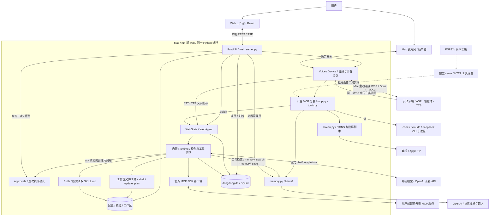
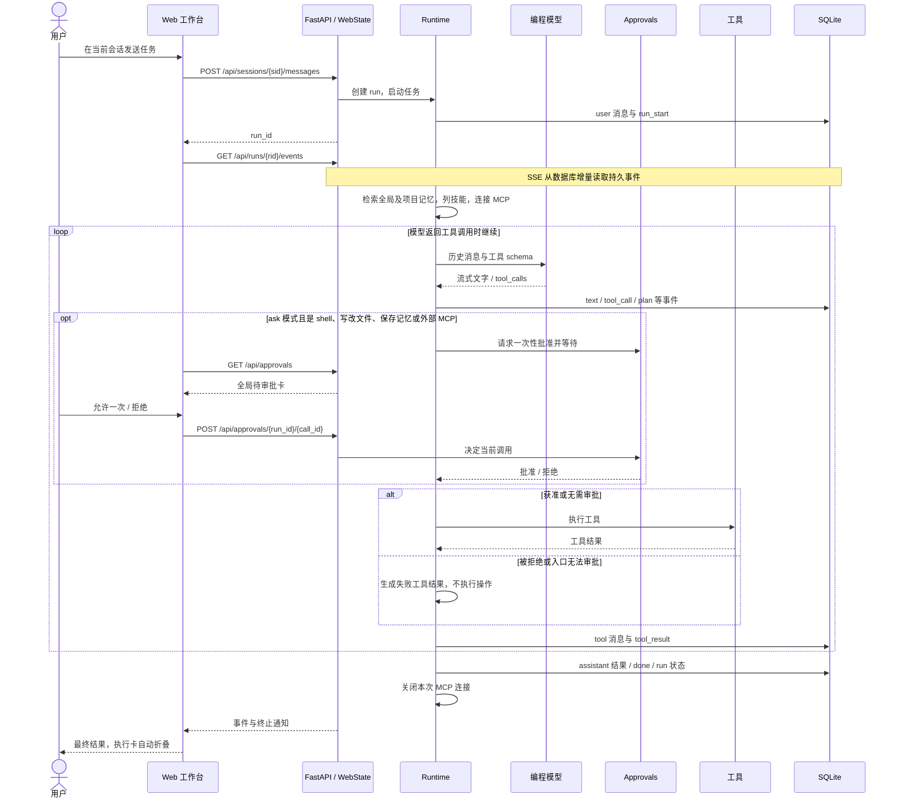
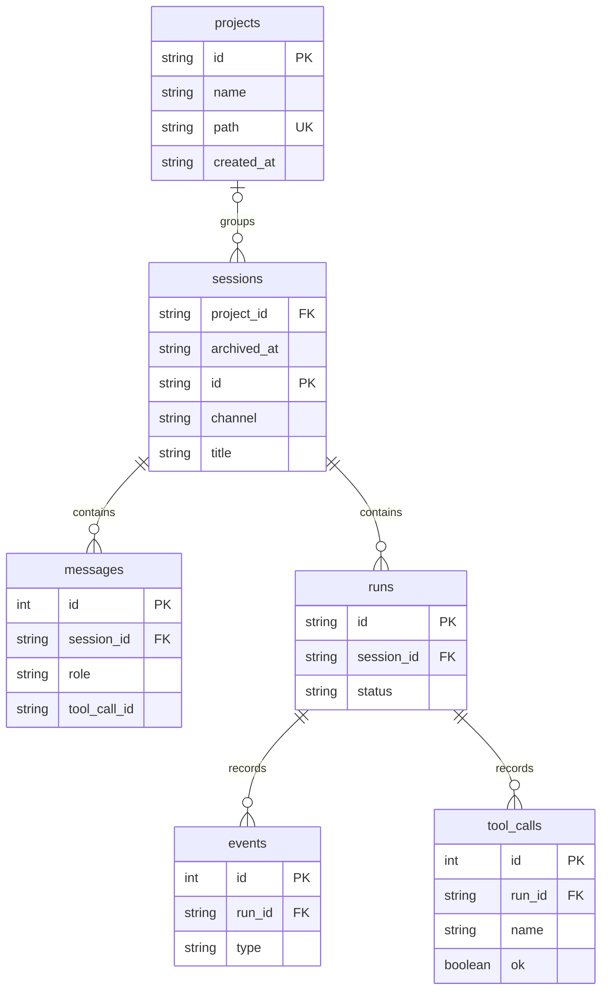

# 项目架构

> 按 2026-10-25 的代码核对，含项目/记忆/归档实现（最终集成待确认）。本文描述当前实现；未来方案单独标注。文档入口见 [文档导航](README.md)。

## 1. 系统定位

咚咚是在 Mac 上运行的单用户助手：用户从 Web 输入任务，或通过灵矽语音调用设备工具；内置 agent 调用模型、读写工作区和执行命令，并把过程保存为可回看的会话。旧 codex / claude / deepseek CLI 执行路径仍然保留。

生产运行一个 Python 进程即可：FastAPI 同时提供前端静态文件和本地 API。Node 只负责开发与构建；语音按用户选择开启。投屏有设备发现和脚本入口，但默认自动镜像受 macOS 控件限制；ESP32 尚未实施。

## 2. 总体架构图

实线表示已有调用链；虚线表示尚未接入的 ESP32 路线。图中的两个模型角色独立：灵矽智能体负责语音对话与设备工具选择，编程模型负责内置 Runtime 的任务循环。

图中的 `Gate` 是 Runtime 执行工具前的等待点，不是另一套调度器。内置 Runtime 不会自动拥有 `self.screen.*` 或 `self.memory.*`：这些属于设备工具表，由灵矽或本地 `call/serve` 使用；Runtime 通过独立的 `memory_search/save` 工具与自动检索复用同一 Mem0。

## 3. 入口、后端与进程边界

| 入口 | 实际路径 | 会话与执行特点 |
| --- | --- | --- |
| `dongdong run` / `web` | `__main__` → `web_server.serve` | 同一入口，默认 `127.0.0.1:8766`；语音默认关闭，按钮开启 |
| Web 文字消息 | REST → `WebState.start` → `Runtime` | 始终使用内置 agent，不受 `code_backend` 控制 |
| 灵矽 `self.code.run` | Device → `mcp.handle` → `tools` | `code_backend=builtin` 复用 WebState；默认 `cli` 则启动外部 CLI |
| `dongdong chat` | `chat_cli` → `Runtime` | 独立终端会话，不需要灵矽；没有 Web 审批回调 |
| `dongdong call` | `tools.call` | 本地调用设备工具；builtin 按需建立 `AgentService` |
| `dongdong serve` | `bridge` → `tools.call` | 独立 HTTP 转发进程，默认 `127.0.0.1:8765`，供未来固件接入 |
| `bind` / `doctor` / `airplay` | 设备绑定 / 诊断 / 投屏操作 | 辅助命令，不经过 Web 任务循环 |

`run/web` 的 FastAPI、Device、WebState 和 Runtime 共享一个 asyncio 事件循环。Device 用 `asyncio.to_thread` 调用同步设备工具；WebAgent 从该工作线程用 `run_coroutine_threadsafe` 把任务投回主事件循环，因此没有第二套内置 agent 服务。

独立 `call/serve` 未绑定 WebAgent 时，`tools` 才懒建 `AgentService`，在专用线程的事件循环运行 Runtime。CLI 后端的 `agent.py` 管理子进程、输出、同步等待和手动停止，等待超时不自动终止进程；工具循环由相应 CLI 自己完成。builtin 会忽略设备工具参数中的 `agent` 字段。

独立 `call` 是一次性进程，builtin 超过同步等待后不能保证继续：当前服务线程是 daemon，命令退出会结束进程。长任务使用持续运行的 `run/web`；`serve` 可以保持服务运行，但当前尚无统一的有序退出收尾。

`work_gate` 按会话 ID 隔离 Web/内置语音任务，同一对话不可重入，其他对话可继续；配置与独立旧设备入口使用无 scope 的全局独占，活动任务期间拒绝变更。取消清理完成后释放。直接 `chat/Runtime` 不走这道闸门，也没有跨进程锁。不要用多个入口进程同时修改同一工作区。

## 4. 任务执行与实时展示

下图表示正常完成路径，包含工具被拒绝后继续循环的情况。取消和异常不产生 done：清理待审批与运行资源后，分别写 stopped / error，前端保留未完成步骤。

- 自动任务先由无工具结构化 Planner 生成并校验最多 8 个 Item；规划期间运行状态为 `planning`，前端执行卡显示规划进度和 Item 数量。非 JSON、依赖错误、工作区越界或未知 agent 会记录 `planning_error` 并回退单 Item。规划完成后沿用同一 SQLite frontier/claim/lease/worker 循环。
- `update_plan` 由同一个模型循环调用，支持 1–8 步、至多一个进行中；只做可见进度，不替代任务 Planner。
- 每个 run 对应一次用户任务；`run_start.user_message_id` 把执行卡关联到正确消息。工具调用和结果按 call ID 配对。
- SSE 读取持久化事件，不依赖内存消息总线；刷新可重放。会话详情提供消息和 runs，`include_events=true` 可取历史事件快照。
- 默认最多 20 次模型循环、历史软窗口 30 条；当前任务起始消息和完整工具消息对会保留。最终无工具调用时结束；异常或取消留下 error/stopped 状态。
- 前端显示当前步骤、下一步、工具和耗时；终态折叠后仍能展开。用户停止会取消任务、移除待审批、终止相关 shell，并清理本轮外部连接。

## 5. 语音链路与会话连续性

`Voice` 管理开关和 Device 生命周期。Device 通过 OTA 获取设备连接信息，主动建立 WSS；`audio.py` 用 sounddevice 录放 PCM，用 opuslib 编解码 Opus。ASR、普通对话、TTS 在灵矽完成，Mac 不另建 ASR/TTS 服务。

灵矽选择 `self.code.run` 时，builtin 最多同步等 8 秒；未结束返回任务号，后续通过 `self.code.result` 查询或在 Web 查看。关闭语音会断链、停止采音和播报，已派发的编程任务继续；停止任务是独立操作。任务完成后主动再次语音播报尚未实现。

| 身份 | 用途 | 生命周期 |
| --- | --- | --- |
| 灵矽 WS `session_id` | 平台当前连接上下文 | 可能每轮重连，不作为本地会话边界 |
| `messages.source` | 同一会话内区分 `voice` 语音、`discussion` 会议文字和 `agent` 任务消息 | STT/TTS 写入当前对话，口播不进入编程模型上下文；历史独立语音会话不合并 |
| `WebState.task_session` | Web 与 builtin 语音编程任务 | 后续任务复用会话和模型历史，每轮仍建新 run |
| SQLite session / run ID | 可回看的消息、任务与事件 | 持久化保存；运行中的指针只在进程内 |

项目内新建对话更新该项目任务指针；若它是当前语音项目，也清空语音文字指针。仅查看历史或发送另一项目文字任务不切换语音项目。“设为语音项目”才显式切换，按项目保留本进程的任务/语音指针；归档或移动清除相关指针。重启后历史仍在，但当前语音项目回到未分类，指针不恢复，用户需重新选择项目。语音只保存识别/播报文字，不保存音频文件。

## 6. 两种工具体系与能力边界

| 工具体系 | 调用方与协议 | 能力 |
| --- | --- | --- |
| 设备工具 `tools.TOOLS` | 灵矽经 WSS 中 MCP JSON-RPC；`call`；bridge HTTP | `self.system.status`、`self.code.run/result/stop`、`self.screen.list/mirror/stop`、`self.memory.search/save/list/delete` |
| 内置 agent 工具 | Runtime 提供模型 function schema | `shell`、`read_file`、`write_file`、`edit_file`、`list_dir`、`glob`、`grep`、`update_plan`、`read_skill`、`memory_search`、`memory_save`，以及启用的外部 MCP 工具 |

设备路径中咚咚是 MCP 工具提供方；外部路径中咚咚是 MCP 客户端。两者共用“MCP”名称，但没有自动互相注册或桥接。

**Skills。** `skills.py` 从本地目录发现名称/描述，Runtime 只注入启用项摘要；模型需要时调用 `read_skill`。读取限制在技能根目录内，拒绝禁用、穿越、外部符号链接和超过 32KB 的正文。启停供下一任务使用；不自动下载/安装，也不运行技能中的脚本。

**外部 MCP。** `mcp_client.py` 使用官方 SDK，支持 stdio、Streamable HTTP、SSE；工具名映射为 `mcp_<服务名>_<索引>`。每 run 建立连接并在同一 asyncio task 退出；连接/发现默认 15 秒、工具调用默认 60 秒。失败服务写 `mcp_error`，其它能力继续；普通清理异常不会覆盖任务结果或取消。

**审批。** `tool_policy=auto` 默认自动执行；`ask` 对 shell、写/改文件、`memory_save`、所有外部 MCP 工具调用确认一次，只读与计划不确认。审批按当前对话的运行列表展示，换页面仍可批准，切换对话后只显示该对话审批；授权仅匹配 `(run_id, call_id)`，不持久化。CLI 和独立 AgentService 无回调时拒绝需审批操作。服务进程启动/连接本身不属于工具调用审批。

## 7. 数据与存储关系

`messages` 保存模型历史，`events` 保存展示/回放事实，`tool_calls` 保存工具执行记录，三者用途不同。启动按PRAGMA检查新增列并事务迁移，旧ID和记录不变，旧会话 project_id/archived_at 为NULL。归档仅改 archived_at，恢复不更新活跃时间；历史记录不删除。Store 使用 SQLite WAL、外键与线程锁；启动时把遗留 running 任务标为 stopped，不自动续跑。schema 中保留 `settings` 表，但当前设置实际写 JSON，并未使用该表。

| 数据 | 默认位置 | 说明 |
| --- | --- | --- |
| 配置与设备身份 | `~/.dongdong/config.json` | 模型、工作区、token、MCP、禁用技能、执行策略；保存权限 0600 |
| 会话与运行 | `~/.dongdong/dongdong.db` | 文本、工具参数/结果、事件；与记忆库分离 |
| 本地技能 | `~/.dongdong/skills/<name>/SKILL.md` | 已存在的技能文件，用户自行放置 |
| 长期记忆 | 源码仓库根 `.memory/qdrant`、`.memory/history.db` | Mem0 懒初始化；路径由模块位置计算，不随 DONGDONG_HOME 变化 |
| 操作产物 | 会话项目固定目录；未分类用配置 `workspace` | 文件工具限制在本轮根内；绑定Web的语音CLI也使用当前项目，独立CLI用原白名单 |
| 前端构建 | `apps/device-mac/dongdong/static/` | 由 `apps/web` 的 Vite 构建，FastAPI 同源提供 |

`DONGDONG_HOME` 可替换配置、会话库和技能的默认根目录。Mem0 全局沿用 `user_id=device_id`，项目使用 `device_id:project:项目ID` 隔离提取、查询、更新与删除，使用 `OPENAI_API_KEY` 调 OpenAI 提取/嵌入；保存内容和查询文本会发送到 OpenAI。Runtime 每轮按用户消息自动检索全局与会话项目，各≤5条、总注入≤4000字符，标注为参考事实而非指令；无key跳过，失败记录memory_error并继续。不会自动保存整轮对话；明确记住用memory_save，默认项目、global跨项目，无项目回落全局。SDK初始化和操作在线程串行执行；删除先校验全部ID归属。

项目创建后路径固定，只可重命名。WebState按会话决定每个run的目录和记忆，运行中不随浏览变化；移动下一轮生效，既有文件/记忆不动。归档入口只读且服务端拒绝新任务，恢复后继续。新建/切换项目与对话不受后台任务影响；移动、归档/恢复只检查目标对话的任务和模式，忙时409；管理页按明确global/项目范围读写。设备self.memory.*默认当前语音项目，可选scope=global；独立call/serve默认全局。侧栏每组20条分页，不全量轮询历史。

## 8. 模块索引

以下 Python 模块均位于 `apps/device-mac/dongdong/`。

| 模块 | 职责 |
| --- | --- |
| `__main__.py`、`config.py` | 命令分派、默认配置与设备身份 |
| `web_server.py`、`web_runtime.py` | 本地 REST/SSE、生命周期、共享任务和语音入口适配 |
| `voice.py`、`linx.py`、`audio.py` | 语音开关、OTA/WSS、Opus 录放 |
| `mcp.py`、`tools.py` | 平台设备 MCP 协议与设备工具表 |
| `runtime.py`、`llm.py`、`progress.py` | 内置循环、流式模型客户端、计划结构 |
| `builtin_tools.py` | 文件工具、shell、命令取消和输出限制 |
| `skills.py`、`mcp_client.py`、`mcp_routes.py`、`approvals.py` | 三项扩展能力和管理 API |
| `store.py`、`schema.sql`、`projects.py` | 项目、会话归属/归档与运行/事件持久化及API |
| `agent.py`、`agent_service.py`、`chat_cli.py` | CLI 子进程、独立 builtin 服务、终端入口 |
| `memory.py`、`memory_tools.py`、`memory_routes.py` | Mem0命名空间、Runtime工具/自动检索与管理API |
| `screen.py`、`bridge.py` | 投屏、独立 HTTP 转发 |
| `state.py`、`doctor.py` | 设备瞬时状态与诊断 |
| `panel.py`、`panel.html` | 旧面板遗留，当前 run/web 不启动 |
| `apps/web/src/main.jsx`、`Conversation.jsx`、`Sidebar.jsx`、`Memories.jsx` | 会话/SSE、执行卡、分组分页/归档、分层记忆管理 |
| `apps/web/src/Settings.jsx`、`Skills.jsx`、`MCP.jsx`、`Approvals.jsx` | 配置、能力管理与全局审批 |

## 9. 本机与外部边界

Web 仅监听 loopback，并校验 Host/Origin；没有远程账号鉴权，因此不支持公网/局域网直接访问。Mac 主动连接灵矽，不需要为语音开放入站端口。独立 bridge 是另一服务，若为未来 ESP32 开放局域网，需配置 `bridge.token`；它不是 Web 远程访问方案。

文件工具 resolve 后检查工作区边界；CLI cwd 检查 projects 白名单。shell 和外部 MCP 服务仍持有用户进程权限，字符串危险命令拦截与逐次确认都不等于操作系统沙箱。设置 API 不回显模型 key，MCP 列表不回显 env/header 值；用户写入命令参数或 URL 的内容仍会显示，事件库也会保存工具参数与结果。

## 10. 当前状态与演进位置

| 能力 | 状态 |
| --- | --- |
| Web / builtin 编程 / 进度回放 / 连续会话 / 麦克风开关 | 已实现，用户已体验基础语音任务；异常与边界有 smoke 验证 |
| SQLite 调度与自动任务规划 | 已实现规划状态、结构化 Item DAG、失败回退、重试/租约和历史事件展示；Goal 验收证据、修复规划、文件范围冲突、多机调度待后续 |
| Skills / 外部 MCP / 一次性审批 | 已实现，本地 SDK 三传输及完整链路验证；用户自有服务与页面体验待验收 |
| 项目 / 归档 / 分层记忆 | 已实施固定目录、增量迁移、恢复与Runtime自动检索；本地隔离验证，真实页面/云端记忆待用户验收 |
| AirPlay | 设备发现可用；默认脚本在已记录的 MenuBarAgent 环境受阻，支持用户自定义命令 |
| 文件浏览 / 产物预览、长任务主动语音回报 | 尚未实现 |
| ESP32 固件转发 | 仅有规划与 Mac bridge，未烧录/联调 |
| 灵矽自定义模型 `/v1/chat/completions` 入站接口 | 早期备选方案，当前未实现；实际语音走设备 MCP |

当前Web共享4个worker，不同对话的普通任务可并行（超过线程数等待空闲worker），由TaskManager管理Run/Goal/Item/Attempt；自动任务先规划再落 Item，规划失败回退单 Item。过期 lease 会重新开放 Item，重启暂停遗留调度任务并要求显式恢复，前端以 SQLite run 投影为准，避免过期 worker 事件继续显示为运行中。Goal 验收证据、修复规划、文件范围冲突、多机调度尚未实现。后续实现依据先查本页和 [决策记录](decisions.md)，历史设计/计划的差异见 [文档导航](README.md)。

## 会议代码修改模式（2026-10-25）

会话内显式开启，固定工作区内 Git 项目目录。`meeting_store.py` 复用 Store 的 SQLite 连接建立 meetings、meeting_discussion、proposals、meeting_controls；方案正文不可变，展示和确认记录独立于正文哈希。多个对话可各自开启会议；目录、讨论、通知、方案、确认与后台运行都按会话 ID 隔离。语音及隐式 MCP 查询/停止跟随当前选中对话，显式 run ID 只作用于该运行；后台完成不改变当前选择。讨论与待确认不挂起 Runtime。

`WebState.voice_text` 将模式内用户 STT 分流到 Meeting；TTS 不作为人类输入。完整“整理一下方案”“按这个方案实施”由本地控制解析，普通 STT 仅登记讨论。云端 `self.code.run` 在此模式只查状态，不发起新执行；两个入口不能合成第二次确认。`/api/meetings/{sid}` 管模式与查询，`/actions` 生成/确认/显式恢复；方案 shown 和产物接口都校验所属会话与版本。

生成 run 使用独立上下文、只读文件工具及 read_birdview/submit_proposal；宿主固定参数调用上游来源发现和渲染器，不开放 shell、产品写入或外部 MCP。生成讨论截止序号固定，晚到意见使确认失效。当前源码包含 untracked/未提交内容的指纹，确认时再次比对。

确认通过 SQLite 条件更新只领取当前已展示版本一次；实施 run 接固定方案、受约束写文件工具和阶段记录。shell 结束后对比 Git 可见源码指纹，额外变化会停止并报告；被忽略/项目外文件不在检查范围，原有权限边界不能保证文件级隔离。扩范围抛 ScopeChange 中止循环，现有取消等待子进程清理。最终 meeting_result 记录检查、变更统计和产物 ID；SSE 等宿主收尾才结束，避免丢最后事件。

`vendor/birdview` 是固定 MIT 上游分发，渲染依赖锁与图标许可随包保存。HTML 保存在 `~/.dongdong/meetings/<id>/`，仅按已注册 ID 读取，CSP sandbox + iframe 只允许脚本、不允许同源权限。显示回执在 iframe load 后复查 HTML 读取成功，并检查服务器产物存在，不证明人已阅读；真实浏览器视觉验收另行执行。前端 Meeting.jsx 提供讨论、历史方案、地图、确认、恢复和检查回看。

调度数据库操作位于task_store.py，Store复用同一连接/锁；TaskExecutor复用既有run与用户消息，不重复创建记录。web_agent.py桥接设备同步调用；task_tools.py注册任务查询/停止/恢复。故事场景协议与安全SVG/存储已在main，完整故事模式尚未交付。
