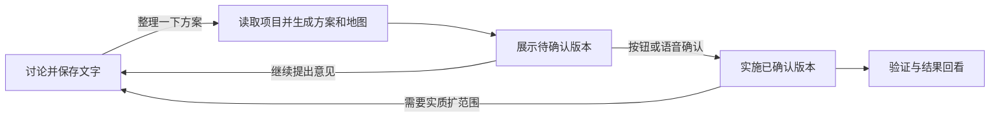

# 会议代码修改模式与 Birdview 集成

> 状态：会议交互已逐项确认；本文是待审阅的完整设计，尚未实施。
> 调研基线：咚咚 `f7c117e`；Birdview main `cdea5340f9710d71c9375e1ca99910c6f59c9704`（0.4.0）。

## 1. 已确认的使用场景

会议中多人讨论同一项目，工作台显式进入“代码修改模式”。Code Agent 根据讨论形成解决方案和改动地图，人确定后由 Agent 实施。

已确认：

- 仅在代码修改模式中启动这套能力。
- 大家说“咚咚，整理一下方案”时才生成或更新方案、地图；普通讨论不自动触发。
- 工作台可以用按钮确认，也允许说“按这个方案实施”来确认。
- 确认对象是已经展示的具体版本，同一确认不得重复启动执行。

本文建议的实现边界：首版接内置 Runtime；多人共享本机会议上下文，不做说话人识别、投票或身份授权。语音沿用灵矽已有 STT，文本输入与按钮提供同等操作入口。麦克风开关仍由用户控制，进入模式不自动采音。

## 2. 集成方案选择

| 方案 | 收益 | 代价 |
| --- | --- | --- |
| 复用 Birdview 技能、契约及渲染器，接入会议工作流（推荐） | 保留证据、约束与改动图，工作台负责讨论、版本和实施衔接 | 增加会议持久记录、产物预览和明确控制入口 |
| 仅安装技能、输出 HTML 文件链接 | 接入小 | 会议上下文、版本确认和实施记录仍脱节 |
| 重写 React 图形编辑器和实时影响分析 | 可完全定制 | 重复上游工作，显著扩大当前范围 |

采用第一种。Birdview 不是自动代码分析服务：Agent 读源码并编写架构与规则数据，上游负责校验、编译与渲染。直接关联的范围外模块只是核查提示，不证明完整影响范围。

## 3. 会议体验

### 3.1 进入与讨论

用户在当前会话开启代码修改模式，明确选择已存在的项目目录；服务端 resolve 并按现有工作区规则检查目录。会话绑定这个目录，模式运行期间不允许悄悄切换项目。首版不依赖尚未交付的项目管理页。

开启后，工作台展示“讨论中”、项目路径和本次会议记录。语音 STT 与手动输入按到达顺序保存；仅将模式开启后的用户讨论作为需求输入。平台 TTS、代码工具输出和 Agent 回复标注各自来源，不能作为人类确认。

多人讨论是已有设备实际收到的转写，不承诺完整收录房间对话；听漏的内容可手动补充。指向同一会话的语音连接重建不切断会议。退出模式后停止向本会议归集新语音，历史保留。

### 3.2 明确召唤

工作台有“整理方案”按钮；语音支持独立指令“咚咚，整理一下方案”，并容忍空格和常见句末标点。普通讨论只保存、不生成地图、不修改产品代码。

召唤时固定讨论截止序号，读取上版方案与截止前的用户意见，沿源码调用方核对架构、约束和具体修改范围。已有有效地图增量复用，不为每轮会议重建全项目地图。

生成期间继续保存新讨论，但不并发生成第二版。新内容不偷偷塞入正在生成的快照，界面提示“有尚未纳入的讨论，请重新整理”；重复召唤返回当前生成任务。渲染失败保留上版，显示失败原因，不把半成品标为待确认。

每版展示需求摘要、解决方案、待决问题、预期行为、拟修改模块和文件、约束、范围外关联模块、验证方式与未检查范围，并附 Birdview 图及源码证据。

### 3.3 展示与修订

方案成功生成后以不可变版本保存。工作台将其放入会议主区域，显示“方案 vN · 待确认”，并保留历史版本入口。方案版本与 Birdview 地图修订号分开：只改方案也增加方案版本，只有地图内容变化才增加地图 revision。

地图在方案生成、执行阶段变化和收尾时刷新，不按语音句子或 token 重绘。上游 HTML 仍为快照；工作台用现有 SSE 通知重新加载对应版本产物。

待确认时出现新的非控制用户讨论，将当前方案标为“有新意见，待重新整理”，暂不接受确认。用户再次召唤后生成下一版；不会在旧方案中悄悄合并新要求。执行中收到的新意见保留为待讨论，不直接扩大当前授权范围。

### 3.4 按钮与语音确认

按钮“确认此方案并实施”和独立语音指令“按这个方案实施”（可带“咚咚”称呼）调用同一个服务端确认操作。服务端在接收控制指令时固定会议、当前待确认方案 ID、版本、内容摘要哈希及展示记录 ID；执行前再做原子校验。

语音只接受完整、明确的控制指令，不以包含某个短语判断。“如果有人说按这个方案实施”“不要按这个方案实施”、TTS 或 Agent 工具参数都不能确认。首版不把自由文本交给模型判断批准意图，不做声纹或主持人身份识别；会议参与者共享这项控制能力。

确认前必须满足：当前处于代码修改模式；存在成功校验且工作台已加载并回执的待确认版本；没有未纳入的新讨论、未解决的阻塞问题或冲突任务；方案内容未变。加载回执只表示页面拿到并展示了产物，不证明人已阅读。

记录确认来源、原话或按钮动作、时间、讨论序号、方案版本与哈希。语音控制记录独立保存，不作为需要重做方案的新意见。按钮和语音同时到达时，原子领取只允许生成一个实施任务，重复操作返回既有任务。

首版采用本地 STT 回调处理这两个明确控制指令，避免云端模型把普通会议讨论改写为直接执行任务。现有 `self.code.run` 在该模式下必须经过同一会议入口：普通指令只登记讨论，整理/实施由会议控制处理；云端 MCP 不得绕过确认启动写代码。来自 STT 与 MCP 的重复控制要复用原动作结果，不能重复创建任务。

语音整理指令的去重可复用当前生成任务；语音实施指令只能消费本地已验证的当前方案确认，不允许 MCP 自行构造确认。云端仅查询动作结果与状态。更新灵矽提示词说明上述路由，不能只靠提示词维持边界。

### 3.5 实施和收尾

确认后直接启动实施，不再询问是否真的要执行。Agent 输入固定方案、项目目录、地图版本和已审查规则，按阶段记录真实编辑与验证结果。现有 `tool_policy=ask` 的逐次工具审批独立保留，方案确认不修改该设置。

检查提交版本和方案相关文件的内容指纹，包括已存在的未提交改动。确认后、实施前若基线有变化，退回重新整理；不能只比较 HEAD 并忽略工作区。不能证明完全静态影响分析或消除外部进程的并发修改风险。

新增模块、扩大修改文件/行为范围或推翻核心约束时停止继续修改，保留已完成部分与实际 diff，返回讨论；再次召唤生成新方案并确认。不能将已执行部分描述为自动回滚。停止任务沿用现有取消和子进程清理，工作台保留未完成状态。

结束后展示修改摘要、实际变更文件、检查命令和退出码、未验证项、Git diff 入口及最后地图快照。Birdview 活动是 Agent 声明，实际工具记录与 Git 变更单独显示；两者不一致应提示，不把 completed 等同测试通过。

## 4. 执行与产物边界

生成方案使用受限工具集：只读项目文件/搜索、读取技能资源、提交方案数据及受控 Birdview 渲染。生成阶段不提供任意 shell、写改产品文件或外部有副作用 MCP；Git 查询和渲染由宿主以固定参数、项目路径和超时执行。需要运行构建/复现命令时先列为待实施的验证，不借只读阶段执行任意代码。

方案和地图 JSON/HTML 写在应用数据目录，代码修改权限留在实施阶段。首版不宣称给任意 shell 提供文件级沙箱；实施仍沿用现有本机单用户执行边界。

Birdview 安装完整固定版本，保留 LICENSE、第三方声明、Schema、参考文档和渲染资源，不只复制 SKILL.md。安装版本、来源提交和依赖锁可追溯；不使用不存在的公开 npm 包安装方式，不自动更新。安装依赖前遵守本项目体积、sudo 和编译库门槛。

复用 `skills.py` 扩展受控参考文档读取，限制在已启用技能目录内，拒绝路径越界、symlink 逃逸和超限文件；返回真实技能根目录。渲染通过固定上游入口运行，Agent 不能提交任意脚本或命令字符串。

HTML 预览使用允许脚本但不允许同源权限的 sandbox iframe，禁止导航顶层页面和调用工作台 API；确认按钮位于宿主界面。产物通过 ID 和不可变版本读取，不能把整个项目目录暴露为静态服务。没有得到展示回执时保留“尚未展示”，不可接受语音确认。

## 5. 持久化与接入位置

沿用 SQLite、现有会话和事件流，不新增服务、通用事件总线或工作流框架。新增数据只解决本场景：

| 记录 | 最少内容 |
| --- | --- |
| 会议 | 会话 ID、固定目录、是否开启模式、当前方案 ID、阶段、讨论截止序号 |
| 讨论 | 用户文本、来源、接收序号和时间；与普通平台 TTS 分开 |
| 方案 | 不可变 ID/版本、结构化方案、讨论快照、地图 ID/revision、约束和源码指纹、哈希、产物位置 |
| 确认/展示 | 具体方案 ID/哈希、展示回执；确认来源与原话、时间、实施任务关联 |

会议阶段是普通数据库枚举和明确条件更新，不写通用状态机。生成与实施各自使用现有 run，讨论和待确认期间不占用一个挂起的模型循环或 asyncio Future。

确认与实施领取持久化，并给方案实施关联加唯一约束。进程若在“已确认但尚未启动”时退出，重启标记待恢复，不自动启动代码；用户显式恢复该版本后再次校验基线，复用同一实施关联，避免重复启动。已停止/失败的任务同样不因重连自动执行。

当前 `WebState.voice_text` 只另存 STT/TTS，须在模式开启时将 STT 分流到选定会议。处理回调仅保存和分派后台任务，不阻塞音频循环。控制指令成功与否立即写入工作台状态；灵矽用现有 MCP 查询结果和播报，不新增未经验证的主动 TTS 推送协议。

`Runtime` 接收本次“生成方案/实施”上下文和相应工具集合；`WebState` 统一管理任务互斥、启动、取消。未来调度内核替换执行宿主时沿用这些记录；本设计不依赖当前尚未全部实施的调度器、项目分组或记忆功能。

工作台在会话内提供模式入口、讨论、方案地图和结果页；通用 API 与语音控制复用同一宿主操作。确认对象由服务器固定，不能依据浏览器正在查看的任意历史页启动。

## 6. 首版验收

1. 普通模式不自动启用 Birdview；开启代码修改模式后只保存讨论，不自动生成方案或改代码。
2. “咚咚，整理一下方案”及按钮均用真实讨论与源码产出可展示的方案和地图，记录覆盖缺口；生成阶段不能调用写改产品文件、任意 shell 或外部执行工具。
3. 讨论中新增意见不自动重绘；再次召唤才生成新版本。生成时新到的意见明确标为未纳入，渲染失败不发布半成品。
4. 展示后的当前版本可通过按钮或语音直接确认并开始实施；否定句、引用、TTS、历史方案、未展示版本和有新意见的方案不能启动。
5. 按钮/语音竞争、STT/MCP 重复动作只生成一个任务；已变更基线、过期哈希及重启后的旧控制不能误执行。
6. 取消后完成子进程清理，失败/部分修改如实记录；扩范围回到讨论与方案确认，不继续静默实施。
7. HTML 预览和技能资源读取不能逃逸各自产物/技能目录，预览脚本不能访问工作台同源权限。
8. 执行记录能回看实际检查结果、来源方案、确认方式和最终变更；未运行验证不显示通过。

按 AGENTS.md，仅在 `tests/smoke.py` 覆盖控制解析、版本/确认/重复执行、工具限制和路径边界，用纯 assert、总检查十秒以内。普通 UI 胶水不加单元测试；用命令行验证完整 HTTP/SSE 链路和前端构建。浏览器或真实麦克风验收按用户授权执行，未执行则如实披露。

## 7. 范围与后续

首版包含完整的“讨论—召唤—方案地图—按钮/语音确认—实施—验证”闭环，先接内置 Runtime。使用真实会议脚本验收后再考虑 CLI 后端接入和独立架构评审入口。

首版不做多人在线协作文档、身份投票、声纹授权、自动会议纪要、每句话触发推理、全仓库精确静态影响分析或原生重写图形编辑器。进入模式不改写用户项目 AGENTS.md，不开启 Birdview 全项目 auto 模式。

上游参考：[README](https://github.com/Qiuner/birdview/blob/cdea5340f9710d71c9375e1ca99910c6f59c9704/README.zh.md)、[活动契约](https://github.com/Qiuner/birdview/blob/cdea5340f9710d71c9375e1ca99910c6f59c9704/references/contract.zh.md)、[交付流程](https://github.com/Qiuner/birdview/blob/cdea5340f9710d71c9375e1ca99910c6f59c9704/references/delivery.zh.md)。这些是调研来源；本文才是拟议的咚咚接入行为。
