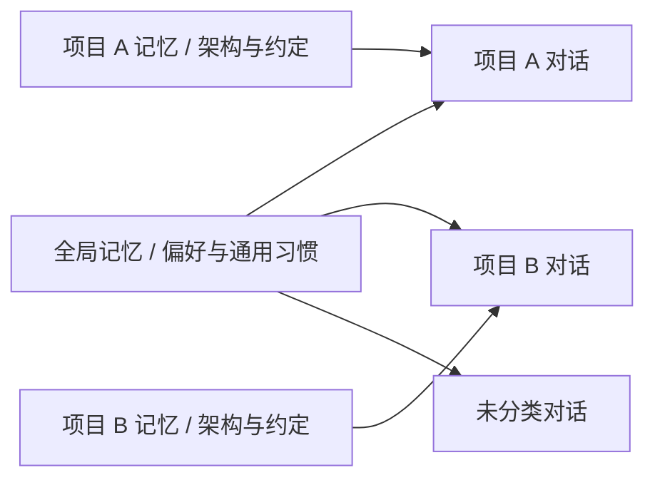

# 项目、分层记忆与对话归档

> 状态：用户已批准并已实施。实现采用既有Store/Runtime/Mem0；本地隔离验证、前端build/SSR和独立审查通过。交付于codex/projects-memory-archive；主目录另有调度器并行改动，本轮未合入或重启。真实浏览器和用户云端记忆服务未验收。

## 1. 用户目标与验收体验

对话持续增长后，用户希望像项目工作台一样管理：按项目找到相关会话；项目知识留在本项目，个人偏好可跨项目复用；暂时不用的对话归档，之后还能查看与恢复。

本轮交付三项连通能力：项目分组与工作目录、全局/项目记忆、可恢复归档。继续沿用单用户、单活动任务、一个 Runtime 和现有 SQLite/Mem0，不增加服务或多 agent 调度。

用户已明确要项目、两层记忆和归档，并确认项目绑定固定本地目录。已批准并实现的选择：记忆读取自动检索，写入由明确的记住操作触发；归档对话恢复后才能续聊。

## 2. 方案选择

| 方案 | 优点 | 代价 |
| --- | --- | --- |
| 仅给会话增加项目标签 | 改动小 | 任务仍用全局目录，项目与执行上下文容易不一致 |
| 项目绑定目录、会话与记忆范围 | 新对话自动选对目录与记忆，语音任务也有明确上下文 | 需要增量数据库迁移和跨入口接入 |
| 每项目独立数据库、模型与 MCP 配置 | 隔离更多设置 | 管理和迁移复杂，超出当前需求 |

采用第二种；模型、Skills、MCP 和执行策略继续共用当前设置。本轮不做每项目配置复制、项目删除、跨设备同步或永久删除对话。

**已确认：** 项目绑定本地目录，采用第二种方案。

## 3. 项目与会话

- 项目包含稳定 ID、名称、绝对目录和创建时间。目录由用户手动填写，展开 `~` 后 resolve，必须已存在；同一真实目录不能重复建项目。
- 用户添加项目即显式选择该工作目录，可位于全局默认工作区之外。目录变更会改变执行含义，首版项目目录创建后固定；允许重命名。
- 一个会话属于零个或一个项目；零项目在界面显示“未分类”，任务仍用全局默认工作区。新会话继承当前项目。
- 旧会话不会按标题、内容或路径自动猜测项目，全部保留在“未分类”；用户可把空闲会话移动到项目。移动不移动文件、不重写历史或已有记忆，下一任务使用新的项目范围，界面明确提示。
- 文件工具和 `cwd` 限制在本次项目目录内；未分类会话继续使用全局工作区。目录不存在时明确报错，不悄悄换到其它项目。
- 浏览历史会话仅改变阅读对象；“设为当前项目”才切换后续语音任务上下文。切换项目后保留各项目最近的未归档任务会话，若无则首次任务新建；重启后由用户重新选择，不从历史猜测。
- 切换执行项目、移动会话、归档正在运行的会话返回409；阅读其它项目/归档记录不受影响。保持当前单活动任务约束。

## 4. 侧栏与归档

侧栏显示“未分类”、可折叠项目和各组最近对话；顶部有“新建项目”，项目旁可新建对话、重命名。列表使用分页/加载更多，避免每3秒把所有历史载入；默认每组展示最近20条，后续按需获取。

会话操作提供“移动到项目”和“归档”。归档仅写 `archived_at`，从普通列表隐藏，消息、运行、事件与工具记录完整保留；不删除磁盘文件、不删除项目记忆。

“已归档”入口可按项目筛选、查看历史与恢复。归档详情只读，保留执行卡和最终结果，显示“恢复后继续对话”；服务端同样拒绝向归档会话发送任务，不仅隐藏输入框。

归档当前空闲任务会话时，清除对应语音指针；下一次语音创建未归档会话，不能把已归档会话重新带回普通列表。普通语音文字会话同样支持归档；后续文字进入新的会话。运行中的会话须先停止/完成再归档。

恢复会话保留原项目与历史顺序信息；排序用已有更新时间，不假装发生了新对话。只有新的消息才更新最近活跃时间。

## 5. 两层记忆

| 行为 | 项目对话 | 未分类对话 |
| --- | --- | --- |
| 检索 | 全局＋本项目；结果带范围标签 | 仅全局 |
| 默认保存 | 当前项目 | 全局 |
| 明确“所有项目都记住” | 全局，工具和界面明确标注 | 全局 |
| 列出/删除 | 用户显式选择全局或本项目范围 | 全局 |

- 沿用 Mem0 的提取/去重，不另建第二套记忆库。旧设备 `user_id=device_id` 原样保留为全局；项目使用由服务端生成的独立命名空间（设备ID＋项目ID）。全局与项目分开调用 SDK 检索，合并后按范围展示。
- **写入与提取必须隔离：** 不只给记录加标签后在前端过滤。Mem0 的写入去重/更新也必须使用项目命名空间，避免项目 A 保存一句话时修改项目 B 或全局记忆；删除先校验完整 ID 列表的设备与范围再执行。
- Runtime 每个任务开始按当前用户消息检索全局及本项目相关记忆，每范围最多5条、总正文最多4000字符，带来源标记注入上下文，并注明记忆是参考事实而非指令。不会读取其它项目或所有历史消息。
- 不默认把每轮完整对话送去提取。用户明确要求记住时，内置 `memory_save` 工具保存，默认项目范围；跨项目保存必须显式 `scope=global`。项目ID从运行会话解析，模型不能传任意项目ID读取其它项目。
- 增加内置记忆查询/保存工具，复用现有工具事件和失败结果；ask 模式下保存也需要一次批准。管理页可直接添加和定向删除，不给模型清空全部能力。
- 设备 `self.memory.*` 沿用相同范围规则：统一 Web 服务绑定当前明确选择的项目，开始调用时固定范围；无项目或独立 `call/serve` 默认全局。CLI 后端自身的模型历史/记忆不受本功能接管。
- 页面增加“记忆”入口，可切换“全局 / 指定项目”，展示范围、内容和定向删除；添加时要求选定范围。没有配置 OpenAI key 时显示未启用，不把空列表误报为没有记忆。
- SDK 初始化和操作放工作线程，串行访问本地 Mem0，不能阻塞音频事件循环。自动检索失败只显示“记忆暂不可用”并继续任务；显式写入/删除失败必须返回真实错误。日志不写正文与密钥。
- 沿用当前 OpenAI key、Mem0存储路径与数据发送约定，不因新增项目偷偷迁移已有向量库。归档不删除记忆，移动会话也不移动已保存记忆。

## 6. 存储与接口边界

SQLite 增加 `projects` 表；`sessions` 增加可空 `project_id` 和 `archived_at`。迁移根据已有列检查后在事务内执行，重复启动幂等；旧库消息/事件/run ID 不变。新增复合索引支持项目、归档状态与最近会话查询，不复制数据库。

沿用现有 Store；项目/会话管理路由放具体业务模块，避免 `web_server.py` 超300行。前端侧栏提取为一个实际复用的组件，main 仍负责当前选择与 SSE，不引全局状态框架。

| API 组 | 已实现行为 |
| --- | --- |
| `/api/projects` | 列表、创建；`/{id}` 重命名；显式选为语音当前项目 |
| `/api/sessions` | 创建时接受 project_id；列表按项目/归档状态与分页查询 |
| `/api/sessions/{sid}` | 返回项目和归档字段；PATCH 支持归属/归档/恢复 |
| `/api/memories` | 显式范围的列表/添加/按ID删除；查询结果带范围 |
| `/api/state` | 保留 active_run，并增加语音当前项目/实际工作目录信息 |

项目/归档操作与任务启动共用 work_gate；服务端用数据库会话决定实际目录和记忆范围。新 run 的范围固定，用户中途浏览页面不能改变执行目录或记忆写入目的地。

## 7. 验证与验收

遵守项目默认不写冗余测试、不 TDD；必须保留的迁移/路径/执行边界仅加 `tests/smoke.py`，仍控制单文件不超过300行。真实 Mem0行为用隔离临时数据验证，不访问用户真实记忆或配置、不自动连接OpenAI计费接口、不操作浏览器。

1. 用旧库夹具迁移两次，会话、消息、run、事件和工具结果保持，旧会话未分类且未归档。
2. 两个目录相互隔离；任务中跨项目 cwd/符号链接越界拒绝，读取历史不改变运行范围。
3. 全局/项目 A/项目 B 记忆搜索、保存、更新、列表、删除均隔离；混入错误范围的删除列表必须整体拒绝，不部分删除。
4. 归档/恢复保留记录；归档运行会话返回409，归档后消息入口拒绝，语音不复用归档会话。
5. 侧栏加载更多、归档入口、恢复后续聊，以及语音原有连续任务/麦克风开关不回归。
6. OpenAI key未配置或服务失败不阻断普通任务，不能误报记忆已写入。
7. 运行 `./scripts/check.sh`、前端构建、CLI隔离 REST/Runtime验证；实际页面体验与用户自有记忆服务单列待验收。

## 8. 实施记录

已按“项目/迁移与归档数据 → 运行目录和语音范围 → 分层记忆 → 侧栏/管理页 → 集成验证”落地。共享文件由根代理串行接入，前端与记忆模块按文件归属并行；最终review、提交/推送和当前分支集成见[实施计划](../plans/2026-10-25-projects-memory-archive.md)。本地验证不替代真实页面与用户自有服务验收。
